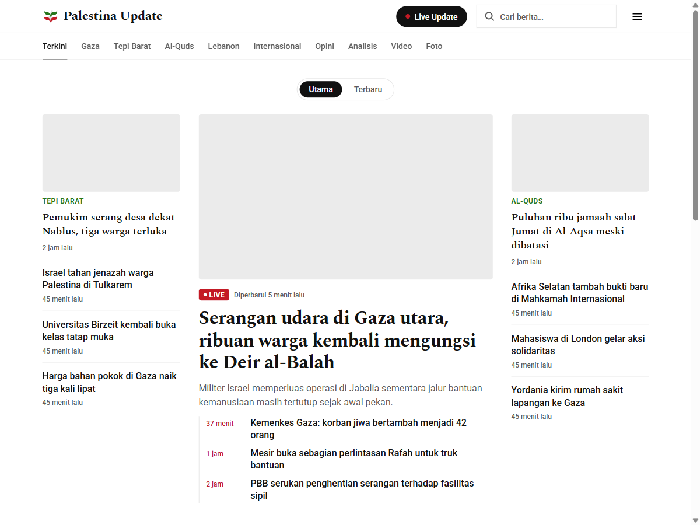

# Plstn-U — Tema WordPress untuk situs berita

Plstn-U adalah tema WordPress untuk situs berita bergaya editorial. Tema ini dibangun di atas [Roots Sage 11](https://roots.io/sage/) dengan Laravel Blade, View Composers, Tailwind CSS v4, dan Alpine.js.

## Fitur utama

- **Light-only.** Tidak ada varian `dark:`. Warna, spasi, dan radius berasal dari blok `@theme` di `theme/resources/css/tokens.css`.
- **Tipografi editorial.** Font Spectral untuk judul dan Roboto untuk antarmuka. Keduanya di-host sendiri dalam format WOFF2 (subset Latin), tanpa CDN eksternal.
- **Beranda berbasis kategori.** Beranda menampilkan berita utama, berita terbaru, dan blok per kategori. Kategori dipilih berdasarkan slug (lihat [Konfigurasi](konfigurasi.md)).
- **Navigasi kategori.** Menu utama dibangun dari kategori induk dan sub-kategori, termasuk di drawer mobile.
- **Pencarian dan drawer.** Memakai elemen `<dialog>` bawaan browser. Alpine.js hanya menyimpan state.
- **Artikel.** Halaman artikel menyiapkan data artikel terkait dan kabar terbaru. Komponen pilihan ukuran teks (normal atau besar) tersedia.
- **Arsip multimedia.** Custom post type `video` dan `infografik` didaftarkan di `mu-plugins/` agar data tetap ada saat tema diganti.
- **Feed RSS.** Feed menyertakan gambar utama, ringkasan, dan feed per kategori (`mu-plugins/pu-feeds.php`).
- **Mode Live.** Tombol Live di navbar bisa dinyalakan lewat satu opsi WordPress.

## Halaman dokumentasi

| Halaman | Isi |
| --- | --- |
| [Persyaratan](persyaratan.md) | Versi PHP, WordPress, Node.js, dan Composer. |
| [Instalasi](instalasi.md) | Cara memasang tema dan `mu-plugins`, serta build aset. |
| [Konfigurasi](konfigurasi.md) | Menu, sidebar, halaman posts, CPT, plugin opsional, Live, dan feed. |
| [Kustomisasi](kustomisasi.md) | Token desain, font, logo, dan teks yang perlu diganti. |
| [Arsitektur](arsitektur.md) | View Composers, komponen Blade, dan aturan pemisahan logika. |

## Lisensi

Tema ini dirilis di bawah lisensi MIT (lihat header `theme/style.css`). Tema ini berbasis Roots Sage, yang juga berlisensi MIT.

!!! note
    Dokumentasi ini ditulis untuk pihak yang memasang dan mengadaptasi tema. Jika ada perbedaan antara dokumentasi dan kode, kode di `theme/` dan `mu-plugins/` yang berlaku.
